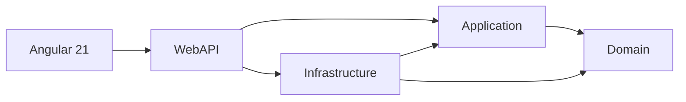

# Ecommerce Clean Architecture

Boutique en ligne full-stack (.NET 9, Angular 21, SQL Server) construite en **Clean Architecture** avec les principes SOLID et plusieurs design patterns.

## Architecture



| Couche | Rôle | Dépend de |
|---|---|---|
| **Domain** | Entités, règles métier (statuts de commande, stock), spécifications, interfaces de dépôt | rien |
| **Application** | Cas d'usage (services), DTO, exceptions métier | Domain |
| **Infrastructure** | EF Core, SQL Server, Identity, génération du JWT | Application, Domain |
| **WebAPI** | Contrôleurs REST, authentification, gestion d'erreurs, rate limiting | Application, Infrastructure |

## Patterns et choix techniques

- **Specification Pattern** : filtres, tri, pagination et includes composables, évalués par un `SpecificationEvaluator`
- **Generic Repository** et **Layer Supertype** (`BaseEntity`)
- **Machine à états** pour les commandes (transitions validées dans le Domain)
- **Concurrence optimiste** (`rowversion`) pour éviter la survente du stock
- **Transaction unique** à la commande : commande + stock + suppression du panier
- **Prix figés** dans la commande (copie du produit à l'achat)
- **ProblemDetails (RFC 9457)** pour toutes les erreurs de l'API
- **JWT + rôles** (Admin / Customer), verrouillage de compte, rate limiting sur la connexion
- **Angular** : composants standalone, signals, RxJS (`switchMap`, `debounceTime`), guards, intercepteurs fonctionnels

## Fonctionnalités

Catalogue (recherche, filtres, tri, pagination), panier serveur, inscription / connexion, commandes (checkout, paiement simulé, annulation avec remise en stock), endpoints d'administration.

## Lancer le projet

### Avec Docker

```powershell
Copy-Item .env.example .env
# Générez une clé JWT et collez-la dans JWT_KEY
[Convert]::ToBase64String((1..48 | ForEach-Object { Get-Random -Maximum 256 }) -as [byte[]])
docker compose up --build
```

L'API écoute sur `http://localhost:5280` (santé : `/health`).

### En local

```powershell
dotnet user-secrets init --project src/WebAPI
dotnet user-secrets set "Jwt:Key" "<32 caractères minimum>" --project src/WebAPI
dotnet user-secrets set "Seed:AdminPassword" "<mot de passe admin>" --project src/WebAPI
dotnet run --project src/WebAPI

cd client-app/client-app
npm ci
npm start
```

Le compte administrateur seedé est `admin@shop.local`.

## Tests

```powershell
dotnet test
```

## Endpoints principaux

| Méthode | Route | Accès |
|---|---|---|
| GET | `/api/products` | Public |
| POST / PUT / DELETE | `/api/products` | Admin |
| GET / POST / PUT / DELETE | `/api/basket/{key}` | Public (clé GUID) |
| POST | `/api/account/register`, `/login` | Public, limité à 10 req/min |
| POST | `/api/orders` | Connecté |
| GET | `/api/orders`, `/api/orders/{id}` | Propriétaire ou Admin |
| POST | `/api/orders/{id}/pay`, `/cancel` | Propriétaire |
| GET / PUT | `/api/orders/admin`, `/api/orders/{id}/status` | Admin |

## Pistes d'amélioration

Paiement réel (Stripe), images produits, pagination côté admin, refresh tokens avec cookie HttpOnly, tests d'intégration (`WebApplicationFactory` + Testcontainers).
